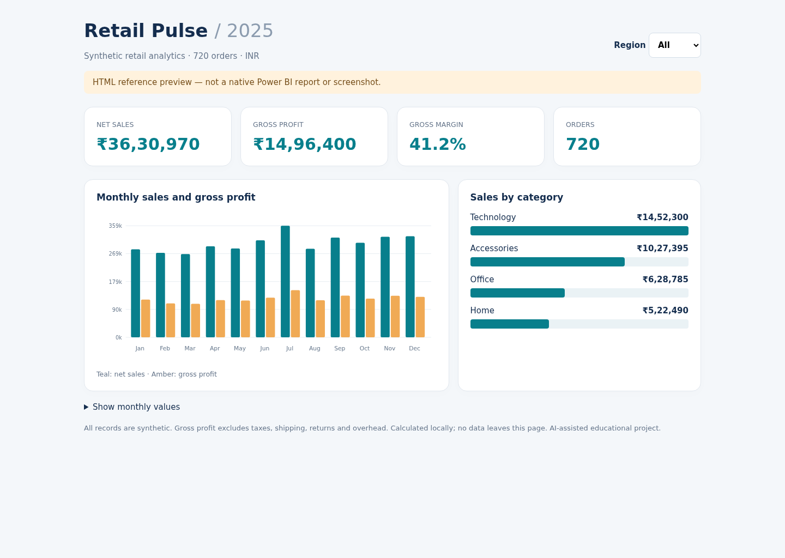

# Retail Pulse — Power BI implementation kit

Reproducible retail analytics data, Power Query transformations, DAX measures and
a report-building guide. Designed to answer: which regions and categories drive
sales and gross profit, and how do sales change month to month?

**This repository is an implementation kit, not a finished `.pbix` or `.pbip`
report.** Power BI Desktop is not available in the Linux validation environment;
M/DAX execution, Desktop import and native report rendering have not been tested.
No web preview is presented as a Power BI screenshot.

All 720 example orders are synthetic (seed 3594), dated in 2025, in INR. No real
customer data, professional experience or production deployment is claimed.
AI-assisted implementation prepared with Wabi.

## What's usable now

- `data/synthetic_sales.csv`: ready-to-import order-level dataset.
- `power-query/Sales.pq`: typed CSV import and recalculated monetary columns.
- `power-query/pSalesCsvPath.pq`: parameter query; change to your local CSV path.
- `dax/`: calculated date table, nine individual measures and a validation query.
- `theme/retail-pulse.json`: Power BI theme.
- `BUILD_REPORT.md`: exact setup, relationships, visuals and formatting steps.
- `data/expected_metrics.json`: all-data and per-region reconciliation targets.
- `preview/index.html`: self-contained interactive HTML reference, no installation
  or server needed. This is NOT a native Power BI report.

## Build in Power BI Desktop (Windows)

Follow [BUILD_REPORT.md](BUILD_REPORT.md). Use a current Power BI Desktop release.
Desktop is not bundled; no paid API/service is required for local preparation.
Publishing to the Power BI service may require a Microsoft account/licence.

## Reproduce data and run checks

Python 3.10+, no third-party dependencies:
```sh
python build_data.py
python -m unittest -v
```
Open `preview/index.html` in a browser and choose a region to explore the same
dataset. Charts and totals update locally. No analytics, trackers or data uploads.

Net sales = units × unit price × (1 − discount). Gross profit excludes taxes,
shipping, overhead and returns. One row is one order, so AOV is valid for this
synthetic grain; for real multi-line orders, preserve DISTINCTCOUNT(OrderID).

## Validation boundaries

`VALIDATION.md` records the actual data/browser checks. Python/JavaScript totals
validate this dataset and the reference preview, **not** DAX/Power Query execution.
For a completed native report, save the Desktop build as `.pbix`, run the supplied
DAX query, compare every metric and capture screenshots from that actual report.
Do not submit the HTML preview as a Power BI output.

## References

- [Power Query CSV import](https://learn.microsoft.com/en-us/powerquery-m/csv-document)
- [DAX DATEADD](https://learn.microsoft.com/en-us/dax/dateadd-function-dax)
- [Power BI date tables](https://learn.microsoft.com/en-us/power-bi/guidance/model-date-tables)
- [Report themes](https://learn.microsoft.com/en-us/power-bi/create-reports/desktop-report-themes)

MIT licensed; data is synthetic and freely reusable.

## Actual preview

This is an HTML reference screenshot, not Power BI output.




See [VALIDATION.md](VALIDATION.md) for checks performed and untested limits.
